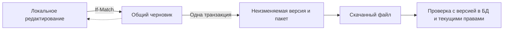

# ADR-0035: Жизненный цикл деклараций — черновик, версия и пакет

**Статус:** принято для реализации STU-02; результаты проверок — в плане Студии.
**Дата:** 2026-10-15
**Основание:** поручение владельца реализовать STU-02 без публикации и merge.
**Зависит от:** ADR-0006, ADR-0020…0025, ADR-0032, ADR-0033.

## 1. Контекст и граница решения

STU-01 проверяет декларацию представления существующей формы и позволяет сохранить её в файл. Файл не решает совместное редактирование, фиксацию проверенной версии и восстановление после обрыва запроса. STU-02 добавляет эти возможности для того же прототипа `example.products`.

В этом этапе **подготовить пакет** означает зафиксировать неизменяемый артефакт, пригодный для последующей процедуры публикации. Это не меняет рабочие формы. API активации, указатель активной версии, применение декларации к обычному `form-meta`, уведомления узлов и изменение схемы данных сюда не входят. Архитектура EntityDefinition/EntityRuntime и QueryList сохраняется. Декларации отчётов и панелей будут отдельными типами в следующих этапах.

Решение о границе основано на результате STU-02 в плане — «черновик, версии, dependencies, проверка и пакет публикации». ACC-11 проверяется здесь в части целостности, повторяемости и атомарности подготовки пакета; часть про переключение активной версии остаётся открытым гейтом будущей активации. ACC-17 и ACC-21 неприменимы до появления такой активации. Подготовленный пакет нельзя называть опубликованной формой.

## 2. Варианты

1. Продолжить хранить только JSON-файлы: не даёт серверной ревизии и надёжной защиты от перезаписи вторым автором.
2. Хранить черновики и версии в существующей PostgreSQL, внутри `md`: выбранный вариант. Транзакции, ревизии и аудит уже есть в платформе; дополнительные сервисы не нужны.
3. Сразу ввести динамический реестр, активные версии и распределённый кэш: расширяет границы этапа, требует отдельной проверки согласованности узлов и открытых форм. Отложено до отдельной задачи активации.

## 3. Модель и инварианты

- Один общий черновик на код поддерживаемой формы. Доступ к нему имеет уполномоченный автор Студии, а не обычный пользователь формы.
- Ревизия черновика увеличивается при каждом успешном сохранении. Создание второго черновика того же кода — конфликт. Обновление требует `If-Match`: без него 428, при устаревшем значении 409. Ошибка не меняет сохранённое состояние.
- Версия — неизменяемый снимок **сохранённой** ревизии с декларацией, зависимостями и контрольной суммой. Номер версии, ревизия черновика и версия формата — разные понятия. Публичных update/delete для версии нет.
- Подготовка версии и её пакета происходит в одной транзакции, сериализованной блокировкой черновика. Уникальность исходной ревизии исключает двойное создание. Повтор при той же текущей ревизии возвращает тот же пакет; устаревший `If-Match` после изменения черновика — 409.
- Ошибка записи/аудита откатывает транзакцию полностью. После потери HTTP-ответа клиент повторяет подготовку с прежней ревизией либо читает историю; частичной версии не остаётся.
- SQL принадлежит репозиторию `md`; сервис отвечает за права, валидацию и транзакцию. Общий валидатор представления не зависит от бизнес-модуля `md`.
- JSON-колонки используют `JsonColumns` и общий `ObjectMapper`. Новые внутренние таблицы — операционное хранилище Студии, не новая пользовательская EntityDefinition. CLI генерации сущностей здесь неприменим: он создаёт пользовательскую сущность, CRUD и права. Их служебная DDL-миграция добавляется отдельно по ADR-0020; выпущенные миграции не меняются.

## 4. Пакет и доверие

Пакет имеет собственную версию формата, идентификацию формы и версии, исходную ревизию, декларацию и отпечаток зависимостей. SHA-256 считается по детерминированному серверному представлению содержимого; порядок полей в JSON-объектах не является изменением смысла, порядок элементов массивов является.

Контрольная сумма сама по себе **не удостоверяет автора**: злоумышленник может пересчитать её. Проверка сопоставляет входной пакет с доверенной неизменяемой версией в БД и заново проверяет зависимости по актуальным разрешённым метаданным. Изменённые поля, пересчитанный checksum, неизвестные свойства, другой код/версия и несовместимые зависимости отклоняются. Сырые байты проверяются до нормализации: дубликаты ключей, неверные типы, trailing JSON, размер и глубина ограничены.

Это проверка пакета в установке, где существует исходная версия. Перенос пакета в другую установку потребует отдельного контракта доверия/импорта; данный checksum не является цифровой подписью и не разрешает произвольный межконтурный импорт. Такой контракт для решений живых форм — [ADR-0047](ADR-0047-solution-packages-and-templates.md) (2026-10-19): пакет решения несёт simple-form-package каждой формы, сумма по-прежнему лишь удостоверяет целостность, а каждая часть проверяется заново путём своего создания; доверие к источнику — решение импортирующего администратора.

## 5. Права, данные и аудит

На этом этапе подготовка пакета относится к авторству: `md.settings.update`, включённый модуль формы, право её просмотра и текущие права полей. Все пути чтения, сохранения, истории, скачивания и проверки заново проверяют доступ. Скрытое или отозванное поле нельзя получить через старую версию или успешный предыдущий preview. Сохранение проверяет также исходный общий черновик: автор, утративший видимость его поля, не может перезаписать его урезанной декларацией и удалить чужие настройки. В пакет не входят значения бизнес-записей; preview использует синтетические значения.

Подготовка пакета не предоставляет полномочий публикации. Перед реализацией активации вводится отдельное право публикатора и проверка доступа к целевому контуру. Назначение прав и обычное использование данных остаются независимыми действиями.

Глобальный HTTP-журнал идемпотентности не должен воспроизводить старый ответ с metadata после отзыва доступа. Операции Студии исключены из него через `@NoIdempotency`; переданный ключ отвергается. Безопасность повторной подготовки обеспечивает уникальность в БД, а не сохранённый HTTP-ответ. Сохранения и фиксация версий используют существующий аудит; декларации и содержимое пакетов не выводятся в прикладной лог.

## 6. UI и восстановление

Редактор сохраняет прежний UI kit, клавиатурные кнопки порядка, preview и импорт/экспорт декларации. Отдельно показывает серверную ревизию, несохранённые изменения и историю версий. Скачивание JSON не означает сохранение в БД. Импорт оставляет декларацию изменённой относительно серверного снимка.

При конфликте ревизии (409) локальный ввод и прежняя ревизия сохраняются. Автор может сохранить файл или явно перечитать серверную версию после подтверждения потери локального ввода. Автоматической перезаписи или скрытой смены ревизии нет. Подготовка версии доступна для сохранённого снимка. Изменение зависимостей пакета (409) отличается от конфликта авторов: интерфейс разрешает явно сохранить тот же layout в новую ревизию и запрещает подготовку до успешного сохранения. Скачивание и проверка пакета не заменяют редактируемый черновик. Ошибки имеют доступные повторные действия; поздний ответ не перезаписывает более новое состояние.

## 7. Эксплуатация и будущая активация

Черновики и версии входят в обычный backup основной БД. Версии — сохраняемые артефакты, не журнал с автоматическим retention; API их удаления в STU-02 нет. История читается страницами с ограничением размера. Миграция только добавляет хранилище, обычные формы его не читают. Это не гарантирует откат старого приложения: SchemaVersionGate требует совпадения БД с миграциями на classpath, поэтому бинарник до V209 нельзя считать совместимым с новой БД. Предпочтительно исправление вперёд с сохранением версий; возврат к резервной копии до миграции выполняется только по [операционной процедуре](../ops/rollback.md), с отдельным подтверждением возможной потери последующих изменений. Таблицы, версии и Flyway history вручную не удаляются; автоматического downgrade нет. Изменённую декларацию исправляют новым черновиком и новой версией. Изменение базового layout, которое делает сохранённый черновик невалидным, блокирует его чтение и сохранение; автоматической миграции деклараций в STU-02 нет. До таких изменений требуется отдельный механизм обновления деклараций.

До будущей активации обязательны: отдельное полномочие публикатора; CAS активной версии; атомарный snapshot для одного запроса; сверка с БД при startup/reconnect и пропущенном сигнале; проверка сохранения открытой формы версии N после изменения N+1; приёмка ACC-11 целиком, ACC-17/21 и эксплуатационные drills. Этот ADR не объявляет эти проверки выполненными.

## 8. Проверка решения

Тесты должны подтвердить CAS двух авторов, 401/403/404, отзыв доступа/скрытое поле, неизменяемость версии после редактирования, повтор и откат подготовки, подмену пакета с пересчитанной суммой, несовместимые зависимости, строгий парсинг, пагинацию и отсутствие изменений обычного metadata/бизнес-данных. UI: конфликт без потери ввода, явное восстановление, история/скачивание, клавиатура, обе темы и экран 360 px.

Фактические команды, RED/GREEN и границы приёмки фиксируются в [плане Студии](../architecture/admin-studio-plan.md). Полный release CI и staging остаются отдельными гейтами; публикация и merge не выполняются.
