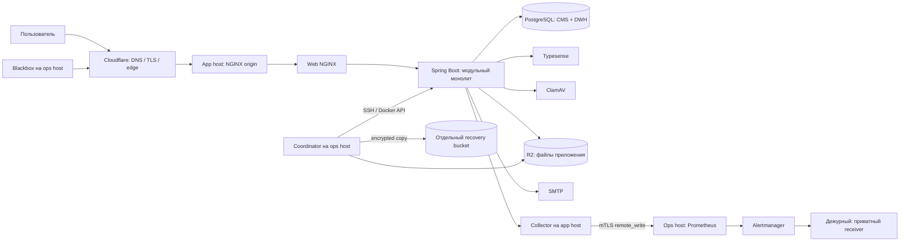

# Эксплуатация SmartupCMS перед первым выпуском

Дата: 2026-10-13. Область: одна организация на установку, Linux + Docker
Compose; утверждённый staging Hetzner + Cloudflare + R2. Это инструкция по
подготовленным средствам, а не свидетельство выполнения приёмки.
Критерии выпуска: [launch checklist](production-launch-checklist.md).

## 1. Архитектура и границы отказа



Приложение и PostgreSQL находятся на одном app host. Это **один домен отказа**;
Compose не предоставляет HA, автоматический failover БД или rolling deployment.
Сохранён модульный монолит: границы модулей, permission/data scope и общие
низкоуровневые библиотеки. Микросервисы и Kubernetes не нужны для текущей
приёмки; добавление узлов требует отдельной проверки распределённых jobs,
SSE, idempotency, session revocation и общего объектного хранилища.

Liveness проверяет процесс, readiness — готовность обслуживать запрос.
Readiness участвует в `compose up --wait`; потеря health сама по себе
не перезапускает контейнер. Restart policy работает при завершении процесса:
[Docker restart policies](https://docs.docker.com/engine/containers/start-containers-automatically/).
Порядок старта задаёт `service_healthy`:
[Compose startup order](https://docs.docker.com/compose/how-tos/startup-order/).

## 2. Prerequisites и доступы

| Область | Проверка до любой установки |
|---|---|
| ОС | Поддерживаемый Linux, синхронизация UTC, обновления безопасности, проверенный reboot |
| Ресурсы | App CCX33: 8 CPU / 32 GB / 240 GB; ops CCX23: 4 CPU / 16 GB / 160 GB и scratch 250 GB |
| Runtime | Docker Engine и Compose с `!override`, `--wait`, `--no-normalize`; версии фиксируются в evidence |
| Ops tools | Python ≥3.11, PowerShell 7, AWS CLI v2, age/age-keygen, tar, Git, cosign, GitHub CLI |
| Автоматизация | Linux controller с Ansible; inventory, host keys, sudo и версии по [Ansible guide](ansible-deployment.md) |
| Доверие | Проверенные SHA релиза, SHA256SUMS digest, signatures/attestations всех шести образов |
| Сеть | Публичный 443; 80 только если выбранный TLS-процесс требует redirect/challenge; SSH только доверенные IP |
| Приватные порты | PostgreSQL 5432, Typesense 8108, ClamAV 3310, management 9090 не доступны из Интернета |
| Monitoring | Ops receiver доступен app collector только по private route с mTLS; UI/API monitoring не публичные |
| Секреты | Env/ключи вне checkout, root-owned 0600; каталоги 0700; резервная копия ключа шифрования отдельно |
| Диски | Шифрование host/volume подтверждено оператором; container volumes не обеспечивают его сами |

Инструменты не устанавливаются deployment runner автоматически: изменения
версий — отдельное проверяемое изменение. SSH fingerprints получают по
доверенному каналу. Результат `ssh-keyscan` без сверки не является доверием.
Cloudflare origin защищается сетевым allowlist/mTLS в соответствии со
[staging acceptance](staging-acceptance.md), а обход edge проверяется отрицательно.

Четыре DB-роли имеют четыре разных пароля: postgres, migrator, runtime,
backup. Все `*_PASSWORD` и `*_PASSWORD_FILE` обязательны и согласованы.
Генератор прекращает работу, если age-keygen не создал настоящий recipient;
фиктивные ключи и загрузка `alpine:latest` не используются.
Учётные данные SMTP/R2/registry/on-call хранятся в secret manager оператора;
встроенный Vault этим изменением не развёрнут. Compose secret files сами по себе
не являются Vault и не обеспечивают encryption at rest.

## 3. Установка и обновление

1. Выбрать immutable release и проверить его provenance, image digests,
   лицензии/SBOM и независимый digest SHA256SUMS. Не выполнять scripts из
   непроверенного архива.
2. Подготовить inventory/vars и private env по [Ansible guide](ansible-deployment.md).
   Скопировать только требуемые секреты. `--check` выполняет структурную
   проверку и не заменяет реальный rehearsal.
3. Подготовить production Compose, optional exporters и staging overlay.
   Сохранять один project name; не запускать вторую установку над теми же томами.
4. Проверить effective Compose без вывода resolved env в журнал:
   `docker compose … config --quiet`. Management/DB/экспортеры не публиковать.
5. Для существующей установки снять новый согласованный recovery set с ops.
   Дождаться его PASS и read-back проверки. Установка блокируется при ошибке.
6. В согласованное окно остановить writers, выполнить миграции и запуск
   через runner. Параллельные deploy запрещены lock; failure не означает
   разрешение автоматически вернуть несовместимое приложение.
7. Проверить readiness, login с синтетическим пользователем, permission deny,
   CRUD/revision conflict, upload/download, поиск, jobs, SSE, SMTP и monitoring.
8. Сохранить release identity, UTC-время, конфигурационные версии без секретов,
   результаты smoke и ответственного. Только после этого направлять трафик.

Zero-touch означает повторяемую установку **после** подготовки доверия,
секретов, hosts и утверждённого окна. Первая настройка DNS, выдача доступов,
подтверждение schema-compatible rollback и решение GO не автоматизируются
неявно. Установка не обещает zero downtime.

## 4. Согласованное резервное копирование

На ops установить `deploy/recovery/smartupcms-recovery.{service,timer}`,
`recovery.json.example`, `recovery-runtime.env.example` и SSH-конфигурацию.
Заменить placeholders, оставить private config в `/etc/smartupcms`.
Compose/env на ops должны описывать **текущую** app-установку; Docker endpoint
`ssh://smartupcms-app` использует проверенные host keys. Доступ к Docker
эквивалентен привилегированному доступу к app host.

Этот APP/OPS recovery-путь рассчитан на S3-compatible storage, включая
утверждённый R2. Удалённый `local_disk` не копируется через SSH автоматически.
Для локального coordinator используется `deploy/compose/docker-compose.local-storage.yml`
и явный `SMC_LOCAL_STORAGE_HOST_PATH` на том же host. Каталог заранее создаётся
с владельцем 10001:10001 и режимом 0750; этот же путь указывается в
`objects.localStoragePath`. Overlay включается в deployment и recovery Compose
с первой установки. Его нельзя добавлять поверх имеющего файлы named volume:
новый mount скроет старые объекты. Привязка identity и проверка полного restore
обязательны; прямой перенос named volume coordinator не выполняет.
Обычный локальный development launch при этом сохраняет `local_disk`.

Scratch монтируется на ops в `/var/lib/smartupcms/recovery`; каталог метрик
`/var/lib/smartupcms/metrics` имеет права 0755, сами `.prom` — 0644.
На ops требуется node-exporter с textfile collector и remote scrape в
Prometheus; его нельзя заменить чтением app exporter: scratch находится на ops.
Backup identity с приватным ключом на app/ops не оставлять после provisioning;
coordinator использует только публичный recipient.

Перед первым deploy установить код coordinator из **проверенного** release
bundle в `/opt/smartupcms/current/scripts/prod`: `recovery_coordinator.py`,
`recovery_support.py`, `verify_recovery_set.py`, `backup-objects.ps1`.
Сохранять root ownership; каталог 0755, файлы 0644, без права записи для
пользователя приложения. Установить unit-файлы в `/etc/systemd/system` с
правами 0644. Private `recovery.json`, `recovery-runtime.env`, SSH private key
и четыре R2 credential files имеют 0600; `known_hosts` проверен заранее.
Подготовить каталоги scratch 0700 и metrics 0755 до запуска unit.
Версию кода coordinator записывать вместе с release evidence и обновлять
в согласованное окно; playbook развёртывания APP не заменяет этот provisioning.

Первоначальный Compose/env на OPS — приватная копия **эффективной текущей**
APP-конфигурации: bind paths относятся к APP Docker host, не к OPS. После
успешного deploy helper сохраняет проверенный snapshot в
`/etc/smartupcms/recovery-current.compose.json` и обновляет ссылку в
`recovery.json`; R2 read credentials остаются отдельными. Не менять эти
файлы во время capture или deploy.

```bash
python3 scripts/prod/recovery_coordinator.py --config /etc/smartupcms/recovery.json --validate-only
sudo systemctl daemon-reload
sudo systemctl start smartupcms-recovery.service
sudo systemctl enable --now smartupcms-recovery.timer
systemctl list-timers smartupcms-recovery.timer
```

Сначала выполнить ручной rehearsal; timer включать после успешного полного
корпуса. Он запускается в 00:00 и 12:00 UTC, не одновременно с k6.
Coordinator проверяет протокол backup worker, блокирует перекрывающий запуск,
приостанавливает автономные dumps, ждёт idle, останавливает server и backup,
снимает CMS/DWH и объекты. Затем возвращает сервисы в работу, загружает шифрованные
файлы и читает каждый обратно для SHA-256. `complete.json` публикуется последним.
При обычной ошибке/таймауте/SIGTERM выполняется ограниченный cleanup.
SIGKILL, power loss и OOM требуют проверки writers по процедуре инцидента.

Полный local cache — максимум один проверенный комплект. Перед следующей
попыткой удаляется только его проверенная локальная копия; remote retention
не меняется. Минимум свободного места — 200 GiB и 20%; это guard,
а не доказательство достаточной ёмкости. Пиковое использование plaintext,
tar и encrypted bytes на корпусе 30 GiB DB + 50 GiB objects измеряется в rehearsal.
Неудачные незавершённые local captures удаляются, чужие каталоги сохраняются.
На app остаётся временный DB dump, который coordinator удаляет после переноса.

Утверждённые цели: полный комплект ≤60 мин, RPO ≤24 ч от `consistentPoint`,
RTO ≤2 ч от отказа до работающего сервиса; remote immutable retention 14 дней,
lifecycle 15 дней. Object Lock и отдельные read/write credentials проверяются
на R2, они не включаются локальным скриптом. Копия в том же R2 account
не защищает от потери всего account.

Для восстановления скачать комплект в изолированный каталог, проверить
`python3 scripts/prod/verify_recovery_set.py --directory <absolute-set-dir>`,
затем передать его CMS/DWH/object archives в `restore-combined.ps1`.
Если на recovery host нет `age` или `pg_restore`, передать `-BackupImage`
с immutable digest проверенного backup image. Mutable tag и test image
по умолчанию не выбираются. Предпочтителен заранее подготовленный host `age`:
coordinator проверяет его наличие до остановки writers.
Использовать отдельные Compose project, тома, object bucket и SMTP sink.
Сверить все object checksums, отсутствие orphan/missing objects, таблицы обеих
БД, логин и прикладной smoke. Требуются два полных target drill.
Таймер restore-скрипта не включает provisioning и решение об аварии.

## 5. Мониторинг и инциденты

На ops объединить `docker-compose.ops.yml` и `docker-compose.alerting.yml`.
Подготовить `prometheus-ops.yml.example`, `blackbox.yml`,
`alertmanager.yml.example`; receiver URL — отдельный secret file.
Для bind-backed Compose secret выставить доступ только container UID 65534
на host: декларация uid/mode не меняет владельца bind-файла.
Внешний probe обращается по HTTPS к JSON API `/api/v1/i18n/ru`, без redirect.
Это проверяет edge и HTTP API; отказ БД дополнительно обнаруживается
readiness/PG metrics. Исключить этот endpoint из CDN cache.

Ops вычисляет stale/missing collector даже если последняя серия `up` равна 1.
Проверяются external availability, полный recovery point, capture failures,
неудачные доставки Alertmanager. Фактическая доставка ≤120 с и ACK ≤10 мин
подтверждаются fault drill. Сбой самого ops/receiver требует отдельного внешнего
dead-man monitor: тот же Alertmanager не может доказать собственную доступность.
Формат приватного webhook receiver:
[официальная конфигурация Alertmanager](https://prometheus.io/docs/alerting/latest/configuration/).

| Ситуация | Действия и эскалация |
|---|---|
| Недоступен API / отказ host | Дежурный немедленно: UTC, release, readiness, disk/OOM; остановить rollout; incident owner ACK ≤10 мин |
| Миграция failed | Writers оставить остановленными; сохранить sanitized Flyway diagnostics; DBA + release owner определяют forward fix/restore |
| Capture failed / lock остался | Проверить process/unit, remote capture container, pause marker, server health; не удалять lock живого процесса |
| После SIGKILL writers stopped | Убедиться, что dump не работает; удалить только свой capture container; снять `/status/pause`, стартовать server+backup и проверить readiness; повторить capture |
| R2/SMTP недоступны | Проверить provider status, TLS/DNS/clock, rate limits и сроки ключей; не открывать bucket/порты для обхода ошибки |
| Диск <20% / backlog растёт | Не запускать нагрузку; проверить собственные tmp/cache/log quotas; не удалять DB volumes и последний remote recovery set |
| Подозрение на компрометацию | Security owner изолирует доступ, сохраняет evidence, отзывает credentials/sessions и определяет доверенную точку восстановления |
| Alertmanager delivery failed | Дежурный использует независимый канал; чинит route/receiver и повторяет test alert |

Назначить людей для ролей primary/secondary on-call, incident commander,
DBA, security owner и release owner до GO. Персональные контакты хранить
в приватном on-call каталоге. Ежедневно: backup age, receiver, certificates,
disk, failed jobs/outbox; еженедельно: restore выборки и dependency triage;
ежемесячно: полный DR rehearsal и проверка восстановления секретов.

## 6. Откат и обслуживание

Откат только приложения допустим, если предыдущая подписанная версия
проверена на **текущей** схеме и явно одобрена release owner.
Не запускать старый migrator против новой схемы. При несовместимой/частично
применённой миграции — forward fix либо восстановление полного recovery set
в отдельную установку, проверка и controlled cutover. Перед cutover зафиксировать
допустимую потерю данных/RPO и остановить writers исходной установки.
Автоматический destructive restore production БД отсутствует.

Патчи: immutable image digest → SBOM/vulnerability scan → полный CI →
rehearsal/rollback → утверждение окна → deploy runner → smoke/monitoring.
Переустановка по mutable `latest` и непроверенный `apt upgrade` не часть deploy.
Ротация: новый scoped secret в secret manager → private file → обновление
соответствующей DB-роли/провайдера → контролируемый restart →
проверка нового и отзыв старого. Изменение файла без изменения пароля в
существующем PostgreSQL не ротирует роль. `SMC_SECRETS_KEY` нельзя заменить
как обычный пароль: нужен предусмотренный приложением re-encryption процесс.
Восстановление без него теряет доступ к зашифрованным значениям.

Логи JSON/trace_id полезны для диагностики, но локальная ротация Docker не
обеспечивает off-host retention. До GO определить privacy/retention и проверить
сбор sanitized логов во внешнюю систему. DEBUG, дампы запросов, токены,
содержимое файлов и персональные данные не пересылать в тикеты/чат.
